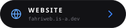
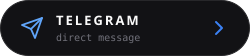
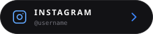

 

**Beginner Web Developer** yang suka membangun tampilan bersih, cepat, dan fungsional. 
Semua dibuat dengan HTML, CSS, dan JavaScript. Satu proyek kecil pada satu waktu.

 

 

 

  

 

  

